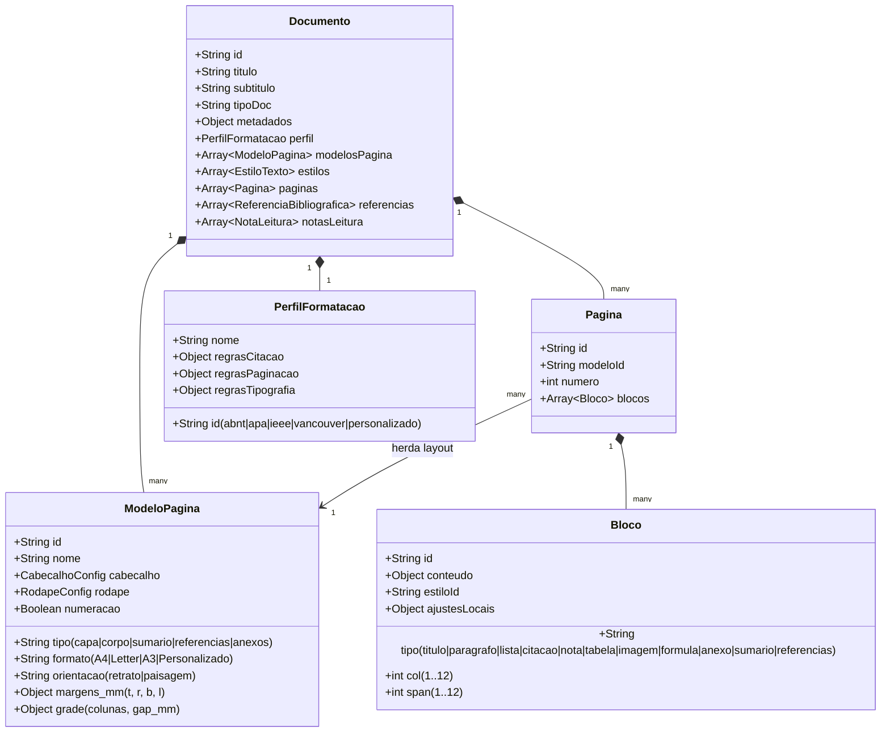

# Athenes — Arquitetura Técnica e Proposta de Interface

> **Athenes**: Ambiente web para escrita e diagramação de relatórios, artigos científicos e documentos acadêmicos baseado na base técnica do **Clux.js**.

---

## 1. Estudo Comparativo das Bases Existentes

O projeto **Athenes** nasce da evolução conceitual e técnica de dois pilares desenvolvidos na família de ferramentas Glaux / Clux:

| Dimensão | Gerador de PDF Web (`glaux_relatorio_modelo.js`) | Estrutura de Pranchas Desktop (`src/core/prancha.*`) | Síntese no **Athenes** (Web) |
| :--- | :--- | :--- | :--- |
| **Modelo de Página** | Folhas A4 (retrato/paisagem), margens em milímetros, cabeçalho e rodapé globais com `@page`. | `ModeloFolha` (A0–A4 + personalizado), 4 margens independentes, encadernação de 25 mm, molduras. | Modelos reutilizáveis por página (**Capa, Corpo, Sumário, Referências, Anexos**). Margens e sangrias individuais; cabeçalhos e rodapés herdados do modelo sem apagar edições da página. |
| **Grid e Colunas** | Grade fixa de 12 colunas proporcionais com espaçamento milimétrico (`larguraDoBloco`). | Grade de colunas × linhas com subgrade fina e snap magnético. | Grid modular configurável (1 a 12 colunas, larguras e gutters ajustáveis), réguas horizontal/vertical (mm/pt), guias arrastáveis e alternância entre snap e posicionamento livre. |
| **Blocos de Conteúdo** | Título, texto, campos rótulo/valor, imagem, tabela de dados, KPIs, linha, espaço, quebra. | Itens posicionados (mapa, quadro de dados, texto, tabela, carimbo, legenda, cotas). | **Editor de blocos completo para escrita**: Título (H1–H4), Subtítulo, Parágrafo com recuos, Citação direta (ABNT 4 cm / APA), Listas (bullets, números, tarefas), Tabelas formatadas, Imagens com legenda/fonte, Notas/Callouts, Fórmulas, Mídias/PDFs anexados, Sumário e Bibliografia. |
| **Escrita e Edição** | Campos de texto na barra lateral; prévia passiva por `postMessage`. | Propriedades no painel lateral direito; edição de tabelas por diálogo modal separado. | **Edição direta dentro do bloco na própria página (WYSIWYG inline)**. A barra lateral serve para ajustes avançados e tipografia refinada; a digitação flui na folha. |
| **Tipografia** | Estilos de texto com catálogo compartilhado (`estilosPadrao`), fontes seguras (Nunito, Times, Arial...), badges (`envolverFundo`). | `EstiloParte` (fonte, tamanho mm, peso, itálico, alinhamento, caixa, espaçamento entre linhas). | Sistema profissional hierárquico inspirado no InDesign e Affinity Publisher: corpos, pesos, entrelinha proporcional/absoluta, recuo de 1ª linha, recuo francês, kerning, hifenização automática e regras de manter com o próximo (`break-after: avoid`). |
| **Vínculos e Acadêmico** | Variáveis interpolares de banco GIS (`{{lote.area_m2}}`, `{{titular.nome}}`). | Resolução de campos territoriais paramétricos (`{prancha.numero}`). | **Totalmente desacoplado de GIS**. Foco em fluxo acadêmico e técnico: metadados do documento, sumário dinâmico, numeração automática de figuras/tabelas, citações ABNT/APA/IEEE e notas de rodapé. |
| **Integração Zotero** | Inexistente. | Inexistente. | **Integração oficial via Zotero Web API v3** + suporte offline a arquivos BibTeX / CSL-JSON. Pílulas de citação interativas, geração automática de referências bibliográficas, Biblioteca de Leitura com fichamento/notas pessoais e Grafo de Conexões. |
| **Exportação** | HTML A4 imprimível via navegador (`window.print()`). | Desenho vetorial Qt para PDF (`QPrinter` / `QPainter`). | **Exportação Dupla de Alta Fidelidade**: <br>1. **PDF** milimétrico via CSS Paged Media (`@page`, quebras exatas). <br>2. **DOCX nativo** compatível com Microsoft Word e Google Docs, com **Relatório Pré-Voo de Compatibilidade**. |

---

## 2. O que foi Reaproveitado do Clux.js e o que foi Deixado de Fora

### O que foi Reaproveitado:
1. **Lógica Matemática do Grid**: O algoritmo de repartição da área útil em 12 colunas considerando margens esquerda/direita e gutters (`espaco_mm`) foi preservado e ampliado para permitir número variável de colunas (1 a 12).
2. **Sistema de Formatação de Páginas Paged Media**: O CSS com `@page`, dimensionamento milimétrico, margens de encadernação, cabeçalhos, rodapés com caixas de margem (`@bottom-left`, `@bottom-right`) e contadores nativos (`counter(page)` de `counter(pages)`).
3. **Identidade Visual Soft UI**: A paleta refinada de cinzas suaves (`#EFF2F6`), superfícies brancas com sombras leves, o laranja de marca `#FF6B2C`, a tipografia institucional **Nunito** e os ícones lineares com traço de 2px (sem emojis).
4. **Serialização Estruturada e Histórico**: O padrão de modelos serializados em JSON com validação estrita, versões imutáveis, registro de alterações com debounce e desfazer/refazer (Ctrl+Z / Ctrl+Y).

### O que foi Deixado de Fora:
1. **Dependência de Banco de Dados PostGIS / Cartografia**: Foram removidas todas as queries a tabelas de lotes, quadras, núcleos urbanos, áreas complementares e cadastros sociais de campo.
2. **Blocos Territoriais Específicos**: Foram excluídos o bloco de mapa vetorial SVG com camadas espaciais e cotas topográficas, bem como os gráficos de agregação por atributos cadastrais de REURB.
3. **Limitação de Edição em Painel Lateral**: A necessidade de selecionar um bloco e digitar seu texto em um `<textarea>` lateral foi completamente substituída por edição direta na página.

---

## 3. Arquitetura de Dados do Athenes

O modelo de documento do Athenes (`AthenesDocumento`) é puramente declarativo e serializável:



---

## 4. Estrutura do Editor e Fluxo de Trabalho (UI/UX)

```
+-------------------------------------------------------------------------------------------------------+
|  ATHENES   [ Início ]  [ Documentos ]  [ Perfil: ABNT NBR 14724 v ]  [ Zotero: Conectado ]  [ Exportar ]|
+-------------------------------------------------------------------------------------------------------+
| Barra de Formatação: [Estilo: Corpo v] [Nunito v] [12pt v] [ B ] [ I ] [ U ] [ Alinhamento ] [ Citação ]|
+-------------------+---------------------------------------------------------------+-------------------+
| ESTRUTURA DO DOC  |                                                               | INSPETOR / PROPS  |
|                   |  RÉGUA SUPERIOR (mm)  | 0 | 20 | 40 | 60 | 80 | 100 | ... |   |                   |
| + Capa            +---+-----------------------------------------------------------+---+ Modelo da Página  |
|   - Título        | R |                                                           |   - Modelo: Corpo v   |
|   - Autores       | É |   +---------------------------------------------------+   |   - Margens (mm):     |
| + Sumário         | G |   | CABEÇALHO DA PÁGINA (herança do modelo)           |   |     Sup: 30  Esq: 30  |
| + 1. Introdução   | U |   +---------------------------------------------------+   |     Inf: 20  Dir: 20  |
|   - Parágrafo 1   | A |   |                                                   |   |   - Grade: 12 cols    |
|   - Citação direta|   |   | 1. INTRODUÇÃO                                     |   |   - Gutter: 4 mm      |
| + 2. Metodologia  | L |   | [Clique aqui e escreva diretamente na folha...]   |   |                   |
|   - Figura 1      | A |   |                                                   |   | Tipografia Bloco  |
|   - Tabela 1      | T |   | "Citação direta longa com mais de três linhas,    |   |   - Recuo 1ª: 1.25 cm |
| + Referências     | . |   | recuada a 4 cm da margem esquerda..."             |   |   - Entrelinha: 1.5   |
|                   |   |   |                                                   |   |   - Antes: 0 pt       |
| + Novo Bloco      |   |   +---------------------------------------------------+   |   - Depois: 6 pt      |
| + Nova Página     |   |   | Rodapé: Universidade Federal · Página 3 de 12     |   |   - Quebra: Manter    |
+-------------------+---+---+---------------------------------------------------+---+-------------------+
```

---

## 5. Estratégia de Exportação Dupla (PDF e DOCX)

### 5.1 Exportação para PDF
- Renderização limpa em HTML com `@page` CSS milimétrico.
- Fontes Nunito incorporadas offline via WOFF2 em base64 / arquivos locais.
- Quebras forçadas de página e regras de `break-inside: avoid` para tabelas, imagens e quadros.
- Caixas de margem do W3C Paged Media para cabeçalhos e numeração de página precisa.

### 5.2 Exportação para DOCX (Microsoft Word e Google Docs)
- Geração nativa de arquivos `.docx` seguindo o padrão **Office Open XML (ECMA-376)** em pacote ZIP puro (utilizando a API nativa `CompressionStream` do padrão web moderno).
- Mapeamento direto de estilos:
  * Títulos viram estilos padrão `Heading 1`, `Heading 2`, `Heading 3` (reconhecidos imediatamente pelo painel de navegação do Word e do Google Docs).
  * Parágrafos viram `Normal` com atributos de espaçamento (`w:spacing`), recuos (`w:ind`) e entrelinhas (`w:line`).
  * Citações viram parágrafos com recuo esquerdo de 2268 dxa (4 cm) e fonte de 10pt.
  * Tabelas viram `w:tbl` com cabeçalho repetido (`w:tblHeader`), bordas e larguras de célula milimétricas.
  * Imagens viram desenhos embutidos (`word/media/imageN.png`) com ancoragem inline (`wp:inline`).
  * Notas de rodapé viram `w:footnoteReference` associadas a `word/footnotes.xml`.
- **Relatório Pré-Voo de Compatibilidade**: Antes de baixar o DOCX, o Athenes executa uma varredura preventiva em cada bloco, informando com clareza quais elementos de diagramação livre serão adaptados para o fluxo linear do Word/Google Docs, garantindo que o usuário nunca seja surpreendido por perdas silenciosas.
