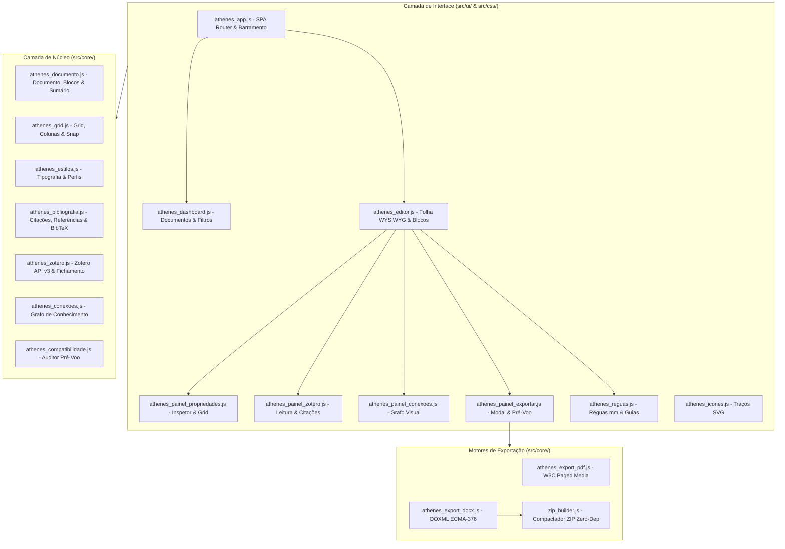

# 10 - Arquitetura Geral e Relação com o Clux.js

Esta nota descreve os fundamentos arquiteturais do **Athenes**, sua herança técnica a partir do **Clux.js** e a separação estrita de responsabilidades entre núcleos matemáticos, interface de usuário e módulos de exportação.

---

## 1. O que é

O **Athenes** é uma evolução do motor de composição visual e gerador de relatórios do **Clux.js**, adaptado para a web como um ambiente completo e independente para escrita e diagramação de artigos científicos, teses e relatórios técnicos.

Ao contrário do Glaux GIS (que lida com cartografia, PostGIS e parcelamento urbano), o Athenes opera de forma **totalmente independente de bases geográficas**, focando exclusivamente na excelência editorial, rigor tipográfico, conformidade acadêmica e fidelidade de exportação para PDF e DOCX.

---

## 2. O que foi Reaproveitado do Clux.js e das Pranchas Desktop

| Módulo de Origem | Recurso Original | Reaproveitamento no Athenes | Adaptação / Evolução |
| :--- | :--- | :--- | :--- |
| **Clux.js — PDF Generator** | Geração HTML com CSS para impressão do navegador (`window.print`) | Motor de Paged Media (`src/core/athenes_export_pdf.js`) | Introdução de `@page` padrão W3C, margens milimétricas exatas, rodapés com `@bottom-right: counter(page)`, estilos de sumário dinâmico e tabelas limpas. |
| **Glaux Desk — Pranchas e Folhas** | Modelo de folhas (`FolhaPrancha`), grade NBR 10068, margens fixas e carimbo paramétrico | Modelos de Página (`src/core/athenes_documento.js` e `athenes_grid.js`) | Separação entre o `ModeloPagina` (reutilizável para capa, corpo, sumário, anexos) e os blocos de conteúdo da folha. Grade modular com 1 a 12 colunas paramétricas. |
| **Glaux Desk — Tipos de Texto** | Catálogo de estilos de parágrafo e caractere com herança (`TipoTexto`, `kTiposPadrao`) | Catálogo Tipográfico e Perfis (`src/core/athenes_estilos.js`) | Catálogo estendido com medidas tipográficas profissionais (pt, recuo 1ª linha, recuo francês, entrelinhas, `break-after: avoid`, hifenização) e perfis editoriais prontos (ABNT, APA, IEEE, Vancouver). |
| **Linguagem Visual Soft UI** | Soft UI claro, Nunito (OFL), `#FF6B2C`, ícones vetoriais de traço | Design System Athenes (`src/css/` e `src/ui/athenes_icones.js`) | Componentes web leves em CSS vanilla, variáveis CSS e catálogo SVG vetorial com stroke 2px sem emojis. |

---

## 3. O que foi Propositalmente Deixado de Fora

Para manter o Athenes ágil, focado e livre de complexidade desnecessária, foram excluídos:
- Camadas GIS, mapas Leaflet e coordenadas geográficas (EPSG/SIRGAS 2000).
- Conexões com banco de dados PostgreSQL/PostGIS e formulários de campo.
- Dependência de bibliotecas pesadas de terceiros (como canvas CAD de C++ ou Qt).
- Componentes e gráficos atrelados a dados cadastrais municipais.

---

## 4. Estrutura de Camadas e Onde Está no Código

### Arquivos do Núcleo:
- `src/core/athenes_documento.js`: Modelo de dados de documentos, páginas, blocos e sumário dinâmico.
- `src/core/athenes_grid.js`: Matemática de grades, réguas e colunas.
- `src/core/athenes_estilos.js`: Definição de estilos, famílias tipográficas e perfis acadêmicos.
- `src/core/athenes_bibliografia.js`: Regras de formatação bibliográfica e parser BibTeX.
- `src/core/athenes_zotero.js`: Cliente de integração HTTP para a Zotero Web API v3.
- `src/core/athenes_conexoes.js`: Algoritmo de montagem e métricas do grafo de relações.
- `src/core/athenes_compatibilidade.js`: Motor de regras para diagnóstico de compatibilidade DOCX.
- `src/core/athenes_export_pdf.js`: Gerador de folha HTML imprimível com CSS Paged Media.
- `src/core/athenes_export_docx.js`: Montador do pacote Office Open XML `.docx`.
- `src/core/zip_builder.js`: Construtor nativo de arquivos ZIP baseado em streams da Web Platform.

---

## 5. Decisões Técnicas e Trade-offs

1. **Zero Dependências no Runtime e Build**:
   - *Decisão*: Não adotar empacotadores como Webpack/Vite ou frameworks pesados (React/Angular). O Athenes funciona nativamente com módulos ES6 em qualquer navegador e roda testes com o Node Test Runner nativo.
   - *Vantagem*: Inicialização instantânea, portabilidade máxima, sem risco de vulnerabilidades de cadeias de suprimentos de pacotes npm, compatível com qualquer servidor estático ou CDN.
2. **Separação Rígida entre Modelo de Página e Conteúdo**:
   - *Decisão*: O conteúdo dos blocos (`blocos: []`) pertence à `Pagina`, mas as propriedades dimensionais pertencem ao `modeloId` vinculado.
   - *Vantagem*: Se o usuário alterar a margem do modelo "Corpo do Texto" de 20 mm para 25 mm, todas as páginas vinculadas são redesenhadas instantaneamente com a nova margem sem que nenhuma palavra digitada seja perdida.
3. **Persistência Local Automatizada**:
   - *Decisão*: Utilizar `localStorage` com autosave debounced para garantir que a escrita não seja perdida durante a navegação.

---

## 6. Verificação e Testes

- Suíte de testes `npm test`: cobre todas as 9 áreas do núcleo em 25 casos de teste automatizados.
- Script de integração `tests/validacao_real.js`: constrói um artigo real de teste com todas as variantes de blocos e exporta simultaneamente para `.docx` e `.html`.

---

## 7. Próximos Passos
- [[11 - Editor de Blocos WYSIWYG]] — ampliação da navegação por teclado e drag-and-drop.
- [[15 - Exportacao PDF e DOCX]] — suporte a binários de imagem empacotados no ZIP.
