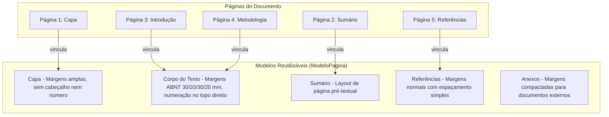

# 12 - Páginas, Grid Modular e Modelos de Página

Esta nota documenta a engenharia de páginas do **Athenes**, abrangendo formatos físicos de papel, margens milimétricas, sistema de grid modular, réguas interativas, guias arrastáveis e a herança entre modelos de página e conteúdo.

---

## 1. O que é

No Athenes, uma página não é um fluxo contínuo indiferenciado, mas uma **folha física de papel com geometria estrita**. O autor tem controle total sobre margens, proporções, cabeçalhos, rodapés e numeração.

O sistema baseia-se em dois pilares:
1. **Separação Rígida entre Modelo de Página e Conteúdo**: O que é dimensional e estrutural reside no `ModeloPagina`. O que é texto e mídia reside na lista de blocos da `Pagina`.
2. **Grid Modular Paramétrico**: Uma grade flexível com suporte de 1 a 12 colunas, permitindo tanto a diagramação tradicional de 1 coluna (ABNT/teses) quanto layouts de 2 colunas (IEEE/artigos científicos) ou colunas assimétricas.

---

## 2. Modelos de Página Pré-Configurados

O Athenes fornece 5 modelos fundamentais que atendem às convenções editoriais internacionais e à norma ABNT NBR 14724:

### Detalhamento dos Modelos:
- **Capa**:
  - Margens: Superior 30 mm, Inferior 30 mm, Esquerda 30 mm, Direita 30 mm.
  - Cabeçalho / Rodapé: Desativados.
  - Numeração: Oculta (contada, mas não impressa).
- **Corpo do Texto (Padrão ABNT / Acadêmico)**:
  - Margens: Superior 30 mm, Esquerda 30 mm, Inferior 20 mm, Direita 20 mm.
  - Cabeçalho: Opcional com título resumido.
  - Numeração: Ativa no canto superior direito (`@top-right`).
  - Colunas: 1 coluna padrão (ou 2 colunas para artigos).
- **Sumário**:
  - Modelo com espaçamento otimizado para linhas pontilhadas de alinhamento com a margem direita.
- **Referências**:
  - Margens idênticas ao corpo, com configuração de parágrafo em espaçamento simples e separação por linha em branco (NBR 6023).
- **Anexos e Apêndices**:
  - Margens reduzidas (20 mm em todas as bordas) para acomodação de tabelas extensas ou páginas digitalizadas.

> [!IMPORTANT]
> **Herança Dinâmica**: Se o autor alterar as margens do modelo `Corpo do Texto` no inspetor lateral (por exemplo, mudando a margem esquerda de 30 mm para 25 mm), **todas as páginas vinculadas** a esse modelo assumem a nova dimensão instantaneamente, sem necessidade de reconfiguração manual e sem alterar os blocos de texto.

---

## 3. Matemática do Grid e Unidades

O módulo `src/core/athenes_grid.js` realiza todos os cálculos geométricos com precisão milimétrica e conversão exata para pontos tipográficos (`pt`), pixels de tela (`px`) e unidades de Word (`dxa`):

- **Fatores de Conversão**:
  - $1\text{ in} = 25,4\text{ mm} = 72\text{ pt} = 1440\text{ dxa}$
  - $1\text{ mm} \approx 2,83465\text{ pt} \approx 56,6929\text{ dxa} \approx 3,77953\text{ px}$ (a 96 DPI)

### Cálculo de Colunas:
Para uma página de largura $L$, margem esquerda $M_e$, margem direita $M_d$, número de colunas $N$ e espaçamento entre colunas (gutter) $G$:

$$\text{Largura Útil} = L - (M_e + M_d)$$

$$\text{Largura de Cada Coluna} = \frac{\text{Largura Útil} - (N - 1) \times G}{N}$$

---

## 4. Réguas, Guias e Snap Magnético

### Réguas Milimétricas
- Implementadas via `<canvas>` de alta resolução (`src/ui/athenes_reguas.js`).
- Régua horizontal no topo e vertical na lateral esquerda da folha.
- Marcações a cada 1 mm, traços médios a cada 5 mm e numeração explícita a cada 10 mm (1 cm).
- Indicador visual em tempo real da posição do cursor do mouse.

### Linhas-Guia (Guides)
- O usuário pode clicar sobre a régua horizontal ou vertical e arrastar uma linha-guia azul pontilhada para a folha.
- Posições salvas no estado da página e exibidas durante a diagramação.

### Snap Magnético (Encaixe Automático)
- O algoritmo `aplicarSnap(valor, pontosAtracao, toleranciaMm = 2)` verifica se a posição de um elemento ou bloco está a menos de 2 mm de:
  - Margens da folha (esquerda, direita, superior, inferior).
  - Limites das colunas do grid.
  - Linhas-guia ativas.
- Quando a condição é atendida, a coordenada salta automaticamente para o ponto de atração. O recurso pode ser ligado/desligado com um clique no botão de ímã da barra de ferramentas.

---

## 5. Onde Está no Código

- `src/core/athenes_grid.js`: Funções `obterDimensoesPagina()`, `calcularAreaUtil()`, `calcularGradeColunas()`, `aplicarSnap()` e utilitários de conversão `mmParaPt()`, `ptParaMm()`, `mmParaDxa()`.
- `src/ui/athenes_reguas.js`: Classe `AthenesReguas` que gerencia o desenho das réguas em canvas e o ciclo de vida das linhas-guia.
- `src/ui/athenes_painel_propriedades.js`: Painel de controle de modelo de página, formato, orientação, margens e quantidade de colunas.

---

## 6. Verificação e Testes

- `tests/grid.test.js`:
  - Valida dimensões em mm para A4 Retrato (210 × 297 mm), A4 Paisagem (297 × 210 mm), Carta e A3.
  - Valida cálculo de área útil descontando margens físicas assimétricas (30/20/30/20 mm).
  - Valida divisão precisa de grade em 2 e 3 colunas com gutter proporcional.
  - Valida atração magnética do snap dentro do limiar de 2 mm e rejeição fora do limiar.

---

## 7. Próximos Passos
- Adicionar opção de páginas espelhadas (margens interna e externa alternadas para impressão frente e verso).
- Implementar sangria (bleed) configurável para relatórios com elementos gráficos até a borda do papel.
