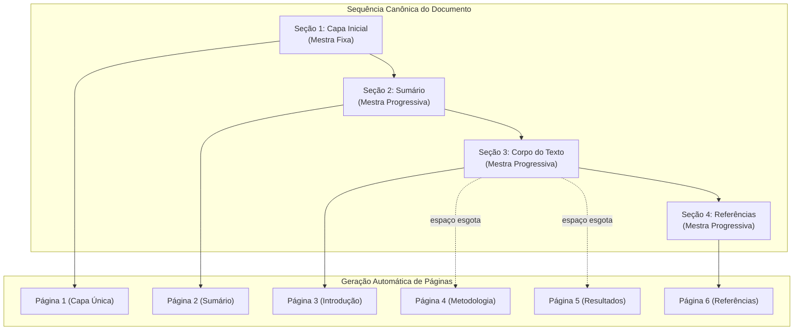

# 12 - Páginas, Grid Modular e Páginas Mestras (Fixas e Progressivas)

Esta nota documenta a engenharia de páginas e o sistema de fluxo contínuo do **Athenes**, abrangendo formatos físicos de papel, controle milimétrico de margens, sistema de grid modular de 12 colunas, miniatura proporcional com diagrama de margens (`.rm-folha-mini`) e o motor de repaginação automática baseado em páginas mestras fixas e progressivas.

---

## 1. O que é e Filosofia de Fluxo

No Athenes, a página é consequência direta do fluxo de escrita:
- **A escrita acontece diretamente nos blocos na folha.**
- Ao adicionar texto, imagens, tabelas, quadros ou fórmulas, o motor de repaginação automática calcula a altura dos blocos em pontos tipográficos e gera novas páginas sem que o usuário precise criá-las manualmente.
- O documento é estruturado em **seções ordenadas**, e cada seção vincula-se a uma **página mestra**.
- A troca de mestra ocorre exclusivamente quando o usuário insere uma nova seção, impedindo que a paginação mude de modelo visual por conta própria.

---

## 2. Modos de Aplicação da Mestra: Fixa vs. Progressiva

Toda página mestra possui um modo de aplicação bem definido:

### 1. Modo Fixo (`modo_aplicacao: 'fixa'`)
- Adequado para **Capas, Folhas de Rosto, Certificados ou Páginas Especiais**.
- Gera estritamente uma página individual.
- Se o usuário desejar uma segunda capa ou página de rosto intermediária, insere uma nova seção com mestra fixa.
- Não desdobra páginas extras automaticamente, a menos que haja quebra de página manual forçada.

### 2. Modo Progressivo (`modo_aplicacao: 'progressiva'`)
- Adequado para **Corpo do texto, Sumário, Lista de Figuras, Referências e Anexos**.
- Recebe o fluxo contínuo de blocos.
- Conforme o usuário digita ou insere figuras e tabelas, novas páginas surgem automaticamente com a mesma mestra e mantêm o cabeçalho, rodapé e numeração contínua.

---

## 3. Miniatura da Folha e Diagrama de Margens (`.rm-folha-mini`)

Na coluna esquerda do editor, o painel de margens replica o padrão consagrado do Glaux GIS:
- **Diagrama em Escala (`.rm-folha-mini`, `#rmMDiag`):** Uma miniatura proporcional da página (A4 retrato 210 × 297 mm ou A4 paisagem 297 × 210 mm) exibe em tempo real um retângulo pontilhado em laranja `#FF6B2C` com preenchimento semitransparente, indicando visualmente as proporções da área útil:
  $$\text{inset} = \frac{\text{topo}}{H} \times 100\% \quad \frac{\text{direita}}{W} \times 100\% \quad \frac{\text{base}}{H} \times 100\% \quad \frac{\text{esquerda}}{W} \times 100\%$$
- **Campos Numéricos com `mm`:** Quatro entradas numéricas em pílula (`rmMT`, `rmMB`, `rmML`, `rmMR`) com sufixo `mm` estilizado.
- **Botão de Elo (`.rm-ic-elo`):** Ao ativar o elo de corrente, alterar qualquer uma das quatro margens propaga imediatamente o valor para as outras três, garantindo margens simétricas quando desejado.

---

## 4. Regra Editorial: Manter com o Próximo (`manterComProximo`)

Para assegurar fidelidade visual profissional e evitar defeitos de diagramação:
- Títulos de seção (`H1`, `H2`, `H3`) possuem por padrão a propriedade `manterComProximo = true`.
- Durante a repaginação automática, se a altura disponível na folha atual comportar o título mas não comportar o título somado ao bloco seguinte (parágrafo ou figura), o motor empurra o título para o início da página seguinte.
- Isso impede que títulos fiquem órfãos e solitários na última linha da folha.

---

## 5. Localização no Código

- `src/core/athenes_documento.js`:
  - `criarModelosPaginaPadrao()`: Catálogo de mestras fixas e progressivas.
  - `repaginarDocumento(doc)`: Motor de fluxo e cálculo de altura em pontos tipográficos.
  - `adicionarSecao()`, `moverSecao()`, `trocarMestraDaSecao()`: Manipulação estrutural.
- `src/ui/athenes_editor.js`:
  - `pintarDiagramaMargens()`: Desenha o inset proporcional do `#rmMDiag`.
  - Lógica de ativação e sincronização do botão `#rmMElo`.
  - Renderização das folhas A4 no palco central (`.ath-folha-a4`).
- `tests/mestras_fluxo.test.js`: Testes automatizados cobrindo fluxo fixo vs progressivo, reordenação e prevenção de títulos órfãos.
