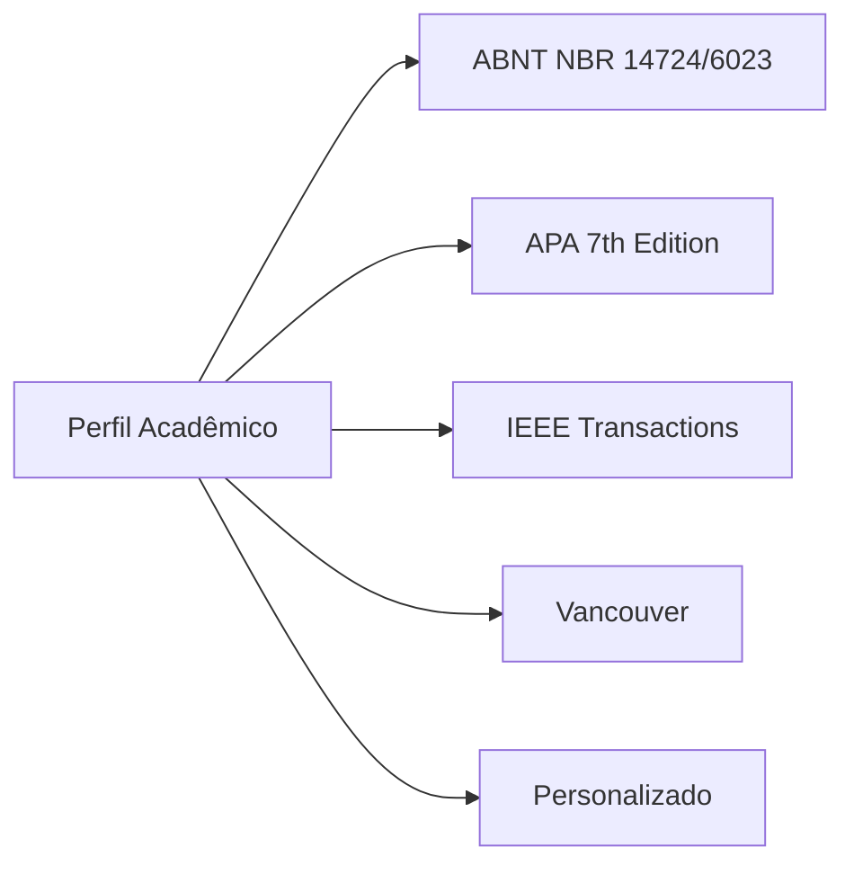

# 13 - Tipografia Avançada e Perfis Acadêmicos

Esta nota detalha a arquitetura do motor tipográfico do **Athenes**, sua amplitude de controle paramétrico (inspirada no Affinity Publisher e InDesign), as fontes offline incorporadas e os perfis normativos automatizados.

---

## 1. O que é

A qualidade editorial de um artigo ou relatório depende de rigor tipográfico. O Athenes oferece controle minucioso sobre medidas de micro e macro-tipografia, permitindo que o autor altere estilos globais que se propagam por todo o documento de forma paramétrica, mantendo suporte a ajustes locais explícitos.

---

## 2. Parâmetros de Controle Tipográfico

O módulo `src/core/athenes_estilos.js` modela cada estilo como uma entidade completa:

| Parâmetro | Unidade | Descrição | Equivalente CSS / OOXML |
| :--- | :--- | :--- | :--- |
| **Família da Fonte** | Nome | Família tipográfica do catálogo | `font-family` / `w:rFonts` |
| **Tamanho da Fonte** | Pontos (`pt`) | Altura do corpo do tipo | `font-size: Xpt` / `w:sz` (meio-ponto) |
| **Peso da Fonte** | 400, 600, 700 | Normal, Semibold ou Negrito | `font-weight` / `w:b` |
| **Alinhamento** | Enum | Esquerda, Centralizado, Direita, Justificado | `text-align` / `w:jc` |
| **Entrelinhas** | Multiplicador / pt | Altura da linha (ex: 1.0, 1.5, 2.0) | `line-height` / `w:spacing w:line` |
| **Espaço Antes** | `pt` | Margem superior antes do parágrafo | `margin-top: Xpt` / `w:spacing w:before` |
| **Espaço Depois** | `pt` | Margem inferior após o parágrafo | `margin-bottom: Xpt` / `w:spacing w:after` |
| **Recuo da 1ª Linha** | `mm` | Indentação positiva da primeira linha | `text-indent: Xmm` / `w:ind w:firstLine` |
| **Recuo Francês** | `mm` | Hanging indent para referências | `padding-left + text-indent negativo` / `w:ind w:hanging` |
| **Manter com Próximo** | Boolean | Evita que títulos fiquem órfãos no fim da folha | `break-after: avoid` / `w:keepNext` |
| **Hifenização** | Boolean | Divisão silábica automática | `hyphens: auto` / `w:hyphenate` |

---

## 3. Catálogo de Fontes e Segurança

O Athenes utiliza uma abordagem híbrida de fontes:
1. **Fonte Padrão Offline de Marca**: **Nunito** (Open Font License - OFL), incorporada no diretório `src/assets/fonts/` em formato WOFF2 leve, garantindo renderização idêntica em qualquer sistema operacional sem conexão com a internet.
2. **Fontes Clássicas do Sistema (Web Safe)**:
   - **Serifadas**: Times New Roman, Georgia, Garamond.
   - **Não Serifadas**: Arial, Calibri, Helvetica, Roboto.
   - **Monoespaçadas**: Courier New, Consolas (para fórmulas e códigos).

> [!NOTE]
> Todas as fontes aceitas pelo sistema possuem flags de licença verificadas para garantir incorporação segura na exportação PDF e preservação no DOCX.

---

## 4. Perfis Acadêmicos e Editoriais

Para poupar o autor de configurar dezenas de propriedades manuais, o Athenes dispõe de perfis pré-estabelecidos que adaptam margens, estilos de títulos, corpo e referências com um único clique:

### 1. ABNT (Associação Brasileira de Normas Técnicas)
- **Normas Atendidas**: NBR 14724 (Trabalhos acadêmicos), NBR 6023 (Referências), NBR 10520 (Citações).
- **Corpo**: Arial ou Times New Roman 12 pt, entrelinhas 1,5, texto justificado, recuo de 1ª linha de 12,5 mm (1,25 cm), espaço depois de 0 pt.
- **Títulos**: Nível 1 em CAIXA ALTA NEGRITO (12 pt), Nível 2 em Caixa Baixa Negrito (12 pt).
- **Citações Longas**: Recuo de 40 mm (4 cm) da margem esquerda, fonte 10 pt, espaçamento simples, sem aspas.
- **Referências**: Alinhadas à esquerda, espaçamento simples entre linhas e separadas por um espaço simples em branco.

### 2. APA (American Psychological Association — 7ª Edição)
- **Corpo**: Times New Roman 12 pt ou Calibri 11 pt, entrelinhas dupla (2,0), alinhamento à esquerda (ragged right), recuo de 1ª linha de 0,5 pol (12,7 mm).
- **Títulos**: Nível 1 centralizado em negrito; Nível 2 alinhado à esquerda em negrito.
- **Referências**: Recuo francês (hanging indent) de 0,5 pol (12,7 mm), entrelinhas dupla.

### 3. IEEE (Institute of Electrical and Electronics Engineers)
- **Formato**: Artigo em 2 colunas com calha (gutter) de 4,2 mm.
- **Corpo**: Times New Roman 10 pt, entrelinhas simples (1,0), texto justificado, recuo de 1ª linha de 3,5 mm.
- **Títulos**: Numerados com algarismos romanos (I. INTRODUÇÃO) centralizados em versalete/caixa alta.
- **Referências**: Citações numéricas entre colchetes `[1]`, referências com recuo numérico.

### 4. Vancouver
- **Área**: Ciências médicas e biomédicas.
- **Corpo**: Arial ou Times New Roman 12 pt, entrelinhas 1,5, citações numéricas sobrescritas ou entre parênteses `(1)`.
- **Referências**: Ordenadas pela ordem estrita de aparição no texto.

---

## 5. Onde Está no Código

- `src/core/athenes_estilos.js`: Catálogo de estilos padrão (`obterEstilosPadrao()`), perfis normativos (`obterPerfisAcademicos()`), conversor de estilo para regras CSS (`converterEstiloParaCSS()`) e catálogo de fontes seguras (`obterFontesDisponiveis()`).
- `src/ui/athenes_painel_propriedades.js`: Interface visual de seleção de perfil, botões de alinhamento com ícones vetoriais de traço, sliders de tamanho e entrelinhas, e inputs numéricos de recuo.

---

## 6. Verificação e Testes

- `tests/estilos.test.js`:
  - Valida presença e integridade das fontes seguras do catálogo.
  - Valida parâmetros exatos dos perfis ABNT, APA e IEEE.
  - Valida geração de string CSS contendo `text-indent`, `line-height`, `break-after: avoid` e regras de hanging indent.

---

## 7. Próximos Passos
- Adicionar suporte a upload de fontes customizadas pelo usuário (`.ttf` / `.woff2`) via `FontFace` API com persistência em IndexedDB.
- Incluir controle de rastreamento de kerning e letter-spacing na barra de propriedades.
