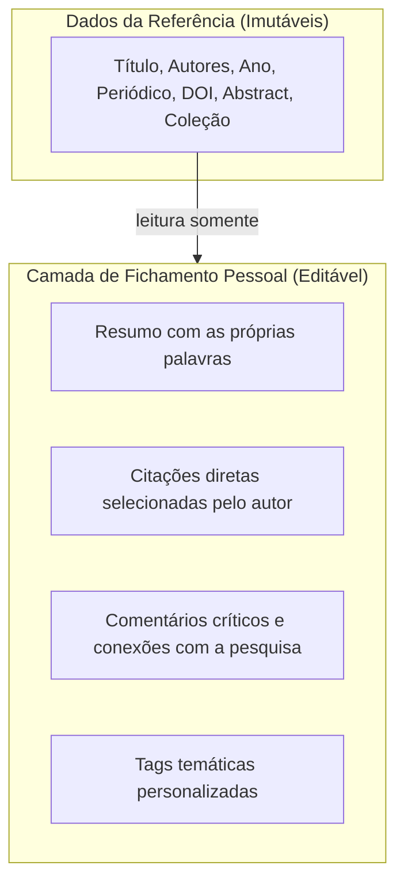
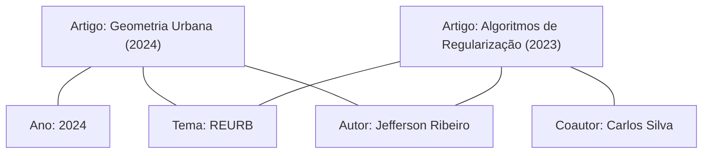

# 14 - Zotero, Biblioteca de Leitura, Fichamento e Grafo de Conexões

Esta nota descreve a integração bibliográfica do **Athenes**, a biblioteca de leitura com fichamento pessoal, o motor de formatação de citações e o grafo visual de conexões de conhecimento.

---

## 1. O que é

Para além de um editor de texto, o Athenes é uma estação de trabalho para o pesquisador. Ele integra o ciclo completo da pesquisa acadêmica: da leitura e fichamento das fontes até a citação no texto e a geração automática das referências finais.

---

## 2. Integração com o Zotero: Decisão Técnica

Antes de implementar, foram estudadas as opções oficiais e vigentes de conexão com o ecossistema Zotero:

| Método | Viabilidade Técnica | Vantagens | Desvantagens / Riscos | Conclusão |
| :--- | :--- | :--- | :--- | :--- |
| **Zotero Web API v3** (Oficial) | **Altíssima** | Padrão REST oficial mantido pela Corporation for Digital Scholarship. Funciona em qualquer navegador, autenticação por API Key, acesso a coleções completas e metadados CSL. | Exige chave de API gerada pelo usuário nas configurações do Zotero.org. | **Adotado como canal principal online.** |
| **Importador BibTeX / CSL-JSON** | **Altíssima** | Zero configuração de rede, 100% offline, exportável por qualquer versão do Zotero Desktop (Ctrl+Shift+E), Mendeley ou JabRef. | Requer exportar o arquivo `.bib` da biblioteca. | **Adotado como canal nativo offline.** |
| **Plugin Desktop Local** | **Baixa / Inconveniente** | Comunicação por porta local (127.0.0.1:23119). | O Zotero 7 abandonou a arquitetura antiga de plugins (XUL/XPCOM), tornando plugins locais altamente frágeis e propensos a falhas de compatibilidade a cada atualização. | **Dispensado**. A Web API v3 e o arquivo BibTeX suprem 100% das necessidades com maior robustez e segurança. |

---

## 3. Biblioteca de Leitura e Fichamento Pessoal

O Athenes estabelece uma separação entre **os dados da obra** e **as anotações do pesquisador**:

- **Isolamento de Dados**: O fichamento pessoal nunca sobrescreve os metadados bibliográficos originais do Zotero. Mesmo que a biblioteca Zotero seja sincronizada novamente, as notas de fichamento permanecem intactas no armazenamento seguro do projeto.
- **Estado de Sincronização**: Cada coleção sincronizada exibe status visual claro (Conectado, Sincronizado, Erro ou Modo Offline).

---

## 4. Inserção de Citações e Geração de Referências

### Citações no Texto
- O pesquisador pesquisa no painel Zotero ou digita `@` ou aciona a barra flutuante.
- Uma pílula de citação semântica é inserida no cursor:
  - Exemplo ABNT: `(RIBEIRO, 2024)` ou `(RIBEIRO; SILVA, 2023)` ou `(RIBEIRO et al., 2022)`.
  - Exemplo APA: `(Ribeiro, 2024)` ou `(Ribeiro & Silva, 2023)` ou `(Ribeiro et al., 2022)`.
  - Exemplo IEEE: `[1]`.

### Referências Automáticas
- O bloco de `referencias` escaneia todas as citações presentes no documento e gera a lista bibliográfica ordenada:
  - **ABNT NBR 6023**: Ordem alfabética pelo sobrenome do primeiro autor em caixa alta, título em destaque (negrito), edição, local, editora e ano.
  - **APA**: Ordem alfabética com recuo francês (hanging indent).
  - **IEEE**: Ordem numérica sequencial de citação no texto.

---

## 5. Grafo de Conexões e Tratamento de Dados Ausentes

O Athenes constrói uma rede interativa de conhecimento a partir das referências da biblioteca:

### Algoritmo de Extração de Rede (`src/core/athenes_conexoes.js`):
- **Nós**: Extraídos dinamicamente em 4 categorias (`obra`, `autor`, `tema`, `ano`).
- **Arestas**: Estabelecidas por:
  - Vínculo de autoria (`obra` $\leftrightarrow$ `autor`).
  - Coautoria (`autor` $\leftrightarrow$ `autor`).
  - Coocorrência temática (`obra` $\leftrightarrow$ `tema`).
  - Contemporaneidade (`obra` $\leftrightarrow$ `ano`).

### Sinalização Explícita de Dados Ausentes
Conforme o princípio de transparência acadêmica do Athenes, dados incompletos nunca são preenchidos com suposições:
- Se uma referência carece de país, cidade de publicação ou palavras-chave, o sistema sinaliza explicitamente: `"País: não informado"` ou `"Tema: não categorizado"`.
- Um **Índice de Completude de Metadados** (0 a 100%) é calculado para cada obra, orientando o pesquisador a completar as lacunas bibliográficas antes da submissão final.

---

## 6. Onde Está no Código

- `src/core/athenes_zotero.js`: Cliente HTTP `AthenesZoteroClient` para autenticação, paginação e normalização de itens da API Zotero.
- `src/core/athenes_bibliografia.js`: Formatadores de autoria (`formatarAutorABNT`, `formatarAutorAPA`), geradores de citação e parser BibTeX offline (`fazerParseBibTeX`).
- `src/core/athenes_conexoes.js`: Motor `construirGrafoConexoes()` e `calcularCompletudeItem()`.
- `src/ui/athenes_painel_zotero.js`: Interface de busca de referências, inserção no cursor e abas de leitura/fichamento.
- `src/ui/athenes_painel_conexoes.js`: Canvas visual interativo com simulação de nós e arestas.

---

## 7. Verificação e Testes

- `tests/zotero.test.js`: Valida construção de URLs da API v3, normalização de registros JSON da API e importação de coleções BibTeX.
- `tests/bibliografia.test.js`: Valida regras de autoria ABNT/APA, geração de pílulas de citação e formatação de livros e artigos.
- `tests/conexoes.test.js`: Valida criação de nós e arestas do grafo e verificação estrita de metadados ausentes.

---

## 8. Próximos Passos
- Adicionar filtros interativos no canvas do grafo para isolar sub-redes de um autor ou ano específico.
- Permitir exportar as notas de fichamento em Markdown ou PDF como relatório de revisão bibliográfica.
