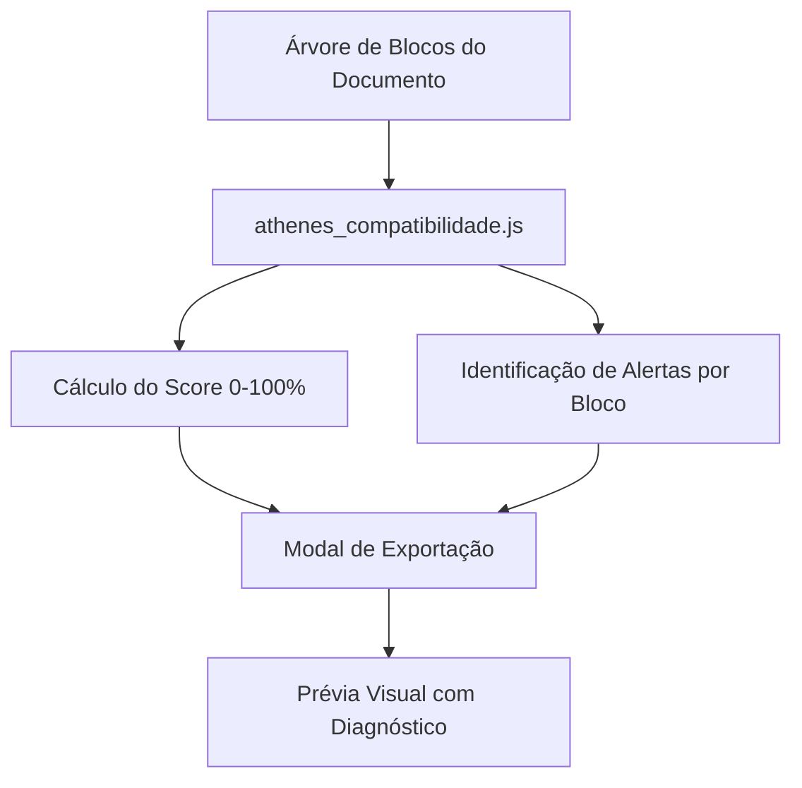

# 15 - Exportação para PDF, DOCX Nativo e Auditoria Pré-Voo

Esta nota detalha os motores de exportação do **Athenes**, cobrindo a especificação W3C CSS Paged Media para PDF, a geração nativa de pacotes Office Open XML (`.docx`) para Microsoft Word e Google Docs, e o relatório preventivo de auditoria pré-voo.

---

## 1. O que é

Uma das maiores dores em editores acadêmicos é a perda de formatação ao exportar documentos. O Athenes foi projetado com uma arquitetura de conversão unificada que garante correspondência estrutural rigorosa tanto na impressão gráfica (PDF) quanto na submissão editorial editável (DOCX).

---

## 2. Exportação para PDF via W3C CSS Paged Media

O módulo `src/core/athenes_export_pdf.js` gera um documento HTML estruturado com regras CSS Paged Media de padrão industrial:

```css
@page {
  size: 210mm 297mm;
  margin: 30mm 20mm 20mm 30mm;
  @top-right {
    content: counter(page);
    font-family: 'Nunito', Arial, sans-serif;
    font-size: 10pt;
  }
}
@page :first {
  margin: 30mm;
  @top-right { content: none; }
  @bottom-center { content: none; }
}
```

### Características Principais:
- **Margens Milimétricas Físicas**: Calculadas a partir do modelo de página ativo.
- **Quebras Controladas**:
  - `break-before: page`: Garante que cada folha do editor comece exatamente em uma nova página física.
  - `break-after: avoid`: Impede que títulos fiquem órfãos no rodapé da página.
  - `break-inside: avoid`: Mantém tabelas curtas e figuras com suas respectivas legendas sem quebra indesejada.
- **Fontes Embutidas**: A fonte Nunito é carregada via `@font-face` local em formato WOFF2, garantindo renderização idêntica em qualquer sistema operacional.

---

## 3. Exportação para DOCX Nativo (Office Open XML - ECMA-376)

O módulo `src/core/athenes_export_docx.js` constrói um pacote binário `.docx` completo a partir de especificações nativas XML, sem depender de conversores externos ou do Word instalado na máquina:

```
documento.docx (arquivo ZIP)
├── [Content_Types].xml               # Definição de tipos MIME (WordprocessingML)
├── _rels/
│   └── .rels                        # Relações do pacote raiz
└── word/
    ├── document.xml                 # Árvore XML de parágrafos, tabelas e blocos
    ├── styles.xml                   # Estilos semânticos (Normal, Heading1, Heading2, Quote)
    ├── numbering.xml                # Definições de listas ordenadas e marcadores
    ├── settings.xml                 # Configurações de compatibilidade (Word & Google Docs)
    ├── header1.xml                  # Cabeçalho da página
    ├── footer1.xml                  # Rodapé com campo dinâmico de numeração PAGE
    └── _rels/
        └── document.xml.rels        # Relações internas de cabeçalho, rodapé e mídias
```

### Compatibilidade Especial com Google Docs:
1. **Estilos Semânticos Oficiais**: Títulos são mapeados para os identificadores `Heading1`, `Heading2` e `Heading3` em `styles.xml`, garantindo que o Google Docs reconheça automaticamente a estrutura no painel de tópicos à esquerda.
2. **Campos Dinâmicos de Página**: O rodapé utiliza `<w:fldSimple w:instr="PAGE"/>`, interpretado nativamente tanto pelo Microsoft Word quanto pelo Google Docs.
3. **Tabelas Robustas**: As larguras das colunas são gravadas em dxa (`w:gridCol w:w="X"`), impedindo que o Google Docs desorganize tabelas com proporções inadequadas.

---

## 4. Relatório Pré-Voo de Compatibilidade (Pre-flight Audit)

O módulo `src/core/athenes_compatibilidade.js` executa uma auditoria completa na árvore do documento antes de permitir ou recomendar a exportação:



### Regras Auditadas:
- **Fórmulas Matemáticas**: Alerta que fórmulas complexas serão representadas em bloco tipográfico monoespaçado no DOCX, sugerindo revisão caso a revista exija notação nativa MathType/OMML.
- **Grades Multicolunas**: Orienta que documentos em 2 colunas serão mapeados para seções de coluna contínua no Word.
- **Tabelas Sem Cabeçalho**: Avisa caso uma tabela não possua primeira linha destacada como cabeçalho repetível.
- **Transparência Absoluta**: O Athenes **nunca substitui silenciosamente texto por imagem**. Caso algum elemento tenha fidelidade reduzida no DOCX, o relatório orienta o autor preventivamente.

---

## 5. Onde Está no Código

- `src/core/athenes_export_pdf.js`: Gerador `gerarHTMLParaPDF()` com CSS Paged Media.
- `src/core/athenes_export_docx.js`: Construtor `gerarPacoteDOCX()` que orquestra a geração de todos os arquivos XML do Office Open XML.
- `src/core/zip_builder.js`: Classe `ZipBuilder` que compacta arquivos em formato ZIP diretamente em `Uint8Array`.
- `src/core/athenes_compatibilidade.js`: Função `gerarRelatorioCompatibilidade()` com diagnóstico de compatibilidade Word / Google Docs.
- `src/ui/athenes_painel_exportar.js`: Modal com abas de pré-voo, botões de download e impressão.

---

## 6. Verificação e Testes

- `tests/pdf_export.test.js`: Valida geração do HTML imprimível, declaração `@page` e atributos de quebra.
- `tests/docx_export.test.js`: Valida criação do pacote ZIP binário e presença de todos os arquivos XML obrigatórios.
- `tests/compatibilidade.test.js`: Valida pontuação e emissão de alertas específicos para fórmulas e tabelas.
- `tests/validacao_real.js`: Gera o arquivo `tests/amostra_artigo_athenes.docx` e valida a descompactação física com o utilitário nativo do Windows.

---

## 7. Próximos Passos
- Empacotamento de binários reais de imagem (`.png`, `.jpg`) no subdiretório `word/media/` do arquivo `.docx`.
- Conversão de fórmulas LaTeX para notação matemática nativa do Word (OMML `<m:oMath>`).
