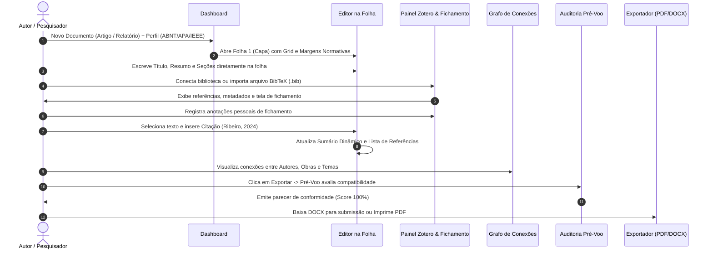

# 90 - Fluxos de Trabalho no Athenes

Esta nota mapeia os principais fluxos de trabalho do pesquisador, autor ou diagramador no **Athenes**, desde a concepção do documento até a publicação final.

---

## 1. Fluxo Geral: Do Projeto à Publicação

---

## 2. Fluxo 1: Escrita e Diagramação de Artigo ABNT

1. **Inicialização**:
   - No Dashboard, clicar em **"Novo Documento"**.
   - Selecionar o tipo **Artigo Científico** e o perfil **ABNT (NBR 14724 / 6023 / 10520)**.
   - O documento nasce com 4 páginas pré-estruturadas:
     - Página 1: Modelo `capa` (título em caixa alta, autores, filiação e resumo).
     - Página 2: Modelo `sumario` (sumário dinâmico com numeração de páginas).
     - Página 3: Modelo `corpo` (introdução, metodologia e desenvolvimento com recuo de 1,25 cm e entrelinhas 1,5).
     - Página 4: Modelo `referencias` (lista ordenada com separação simples).
2. **Escrita In-Page**:
   - Clicar sobre o título da seção para editar o texto diretamente.
   - Pressionar `Enter` para criar um novo parágrafo do corpo.
   - Digitar o conteúdo contínuo com correções automáticas de estilo.
3. **Inserção de Mídias e Figuras**:
   - Adicionar bloco de imagem via barra flutuante ou menu lateral.
   - Digitar a legenda logo abaixo no formato padrão: `"Figura 1 — Arquitetura de camadas do sistema"`.
   - Adicionar a fonte: `"Fonte: Elaborado pelos autores (2026)"`.

---

## 3. Fluxo 2: Gestão Bibliográfica e Citações

1. **Carregamento da Biblioteca**:
   - Abrir o painel **Zotero** na lateral direita.
   - **Opção A (Online)**: Informar a API Key e o User ID do Zotero para sincronizar coleções ativas.
   - **Opção B (Offline)**: Clicar em **"Carregar BibTeX (.bib)"** e selecionar a exportação local do Zotero Desktop.
2. **Leitura e Fichamento**:
   - Clicar sobre qualquer obra da lista para abrir a **Ficha de Leitura**.
   - Ler os metadados (autores, publicação, resumo original).
   - No campo **"Fichamento Pessoal"**, registrar anotações críticas, citações memoráveis e conexões com a tese. As notas são gravadas com isolamento estrito sem poluir o Zotero.
3. **Citação no Cursor**:
   - No editor, posicionar o cursor no ponto desejado e clicar em **"Citar"** na referência desejada.
   - A pílula de citação correspondente à norma ativa é inserida automaticamente (`(RIBEIRO, 2024)` para ABNT ou `(Ribeiro, 2024)` para APA).
   - A página de **Referências** adiciona automaticamente o verbete bibliográfico completo correspondente.

---

## 4. Fluxo 3: Auditoria Pré-Voo e Publicação

1. **Acionamento**:
   - Clicar no botão **"Exportar"** no cabeçalho superior.
2. **Avaliação Pré-Voo**:
   - A aba **"Pré-Voo de Compatibilidade"** analisa todos os blocos do documento.
   - A pontuação de compatibilidade com o Microsoft Word e o Google Docs é calculada:
     - **Fórmulas**: Notifica sobre a formatação do bloco.
     - **Grades**: Verifica alinhamento de colunas.
     - **Tabelas**: Confere cabeçalhos semânticos.
3. **Geração do Arquivo**:
   - **Para envio a periódicos/revisores**: Clicar em **"Baixar DOCX"** (gera pacote binário ZIP Office Open XML puro).
   - **Para leitura final ou impressão gráfica**: Clicar em **"Imprimir / Salvar PDF"** (abre prévia do navegador com CSS Paged Media `@page`).
